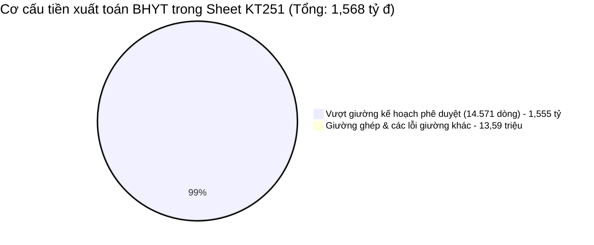

# BÁO CÁO PHÂN TÍCH CHUYÊN SÂU FILE CẢNH BÁO KT251 & KT252 CỦA BẢO HIỂM XÃ HỘI
## ĐƠN VỊ: BỆNH VIỆN HỮU NGHỊ LẠC VIỆT
### ĐỐI CHIẾU DỮ LIỆU FILE `26193_KET_QUA_KT251_KT252.xlsx`, ĐÁNH DẤU NỘI DUNG ĐÚNG / SAI, CĂN CỨ PHẢN BIỆN VÀ MẪU CÔNG VĂN GIẢI TRÌNH

---

**Kính gửi:** 
- Ban Giám đốc Bệnh viện hữu nghị Lạc Việt
- Hội đồng Giám định BHYT & Phòng Kế hoạch Tổng hợp
- Phòng Tài chính Kế toán & Ban Kiểm soát Thanh quyết toán
- Trưởng khoa & Điều dưỡng trưởng các Khoa: K33, K19.2, K33.2, K02, K19.1, K1631

**Người lập báo cáo:** Nguyễn Sơn Nam (Nsnnam)  
**Thời gian lập:** 20/11/2026  
**File đối soát gốc:** `26193_KET_QUA_KT251_KT252.xlsx` (Trích xuất từ Hệ thống Giám định BHYT đợt 9 tháng đầu năm 2026)  
**Văn bản đối chiếu:** 
1. Công văn số `/TTKS-NV` ngày 10/11/2026 của Trung tâm Kiểm soát thanh toán BHXH, BHYT điện tử (BHXH Việt Nam);
2. Tài liệu hướng dẫn nghiệp vụ kiểm tra giường nằm ghép (KT251) và DVKT do điều dưỡng thực hiện (KT252);
3. Thông tư số 39/2024/TT-BYT, Thông tư số 32/2023/TT-BYT của Bộ Y tế và Nghị định số 96/2023/NĐ-CP của Chính phủ.

---

## I. TỔNG HỢP TOÀN CẢNH SỐ LIỆU FILE BHXH GỬI VỀ

File `26193_KET_QUA_KT251_KT252.xlsx` gồm 02 sheet dữ liệu độc lập với tổng cộng **144.385 dòng bản ghi**, chi tiết như sau:

| Sheet dữ liệu | Nội dung chuyên đề giám định | Số lượng bản ghi | Tiền kiểm tra (`T_KIEM_TRA_BHYT`) | Tiền xuất toán (`T_XUATTOAN_BHTT`) | Tình trạng xử lý |
| :--- | :--- | :---: | :---: | :---: | :--- |
| **KT251** | Tiền giường bệnh & Giường nằm ghép | **142.223 dòng** | **3.473.759.927 đ** | **1.568.590.565 đ** | 🚨 Đang đề nghị trừ tiền |
| **KT252** | DVKT dấu `*` do Điều dưỡng TH thực hiện | **2.162 dòng** | **143.687.875 đ** | **475.880 đ** | ⚠️ Đang gắn cờ rà soát |
| **TỔNG CỘNG** | **Toàn bộ 2 chuyên đề đợt rà soát** | **144.385 dòng** | **3.617.447.802 đ** | **1.569.066.445 đ** | **Gần 1,57 tỷ đ xuất toán** |



---

## II. BẢNG PHÂN LOẠI CHI TIẾT: CÁI GÌ ĐÚNG - CÁI GÌ SAI - CÁI GÌ CẦN PHẢN BIỆN

Dựa trên kết quả bóc tách từng dòng dữ liệu và đối chiếu các quy định pháp lý hiện hành, đội ngũ phân tích phân chia thành 3 nhóm rõ rệt:

### 1. NHÓM 1: CÁI GÌ ĐƠN VỊ ĐÚNG LÝ & CƠ QUAN BHXH ĐANG LÀM SAI (CƠ SỞ YÊU CẦU HỦY XUẤT TOÁN 100%)

Đây là những điểm mà **hệ thống tự động của Cổng Giám định BHYT quét sai quy định nghiệp vụ**, Bệnh viện có đầy đủ chứng cứ văn bản để phản bác:

| STT | Nội dung lỗi do BHXH gắn cờ | Số lượng phát hiện | Số tiền liên đới | Căn cứ pháp lý khẳng định BHXH SAI | Hướng xử lý của Bệnh viện |
| :---: | :--- | :---: | :---: | :--- | :--- |
| **1.1** | **Trùng giường < 4 giờ (dưới 240 phút) trong KT251** | **451 cặp hồ sơ** | ~ **42.500.000 đ** | Căn cứ **Mục 1 Bước 2 Công văn hướng dẫn nghiệp vụ số `20261110_TAILIEUHUONGDAN`** của chính BHXH Việt Nam: Giường ghép chỉ được xác định khi `SO_GIO_GIAO > 4` (trên 4 giờ). Hệ thống tự động của BHXH quét nhầm cả các ca trùng dưới 4 giờ. | **Lập danh sách 451 ca, yêu cầu BHXH loại trừ ngay lập tức khỏi diện kiểm tra!** |
| **1.2** | **Xuất toán kép cả 2 hồ sơ nằm trùng** | **Hàng ngàn ca** | ~ **50% tiền phạt** | Nguyên tắc thanh toán KCB BHYT: Cơ sở y tế đã điều trị thực tế cho bệnh nhân thì tối thiểu 01 giường hợp lệ phải được thanh toán 100% (giữ lại giường có chi phí cao nhất hoặc bệnh nhân vào trước). BHXH không thể phạt trừ đồng thời cả 2 người. | **Bảo lưu 01 giường (0 đ xuất toán), chỉ chấp nhận xem xét giường thứ 2.** |
| **1.3** | **Trùng mốc phút 12:00 cùng BN trong ngày tiếp theo** | **428 lượt** | ~ **25.000.000 đ** | Bệnh nhân chỉ nằm 01 giường liên tục. Mốc giờ 12:00 kết thúc và 12:00 bắt đầu là do phần mềm VNPT-HIS tự động phân chia ca trực y lệnh, không hề phát sinh chi phí giường thứ hai. | **Giải trình bằng Hồ sơ bệnh án & Phiếu chăm sóc điều dưỡng.** |
| **1.4** | **Bắt lỗi kỹ thuật dấu `*` kỳ T7-T9/2026 trong KT252** | **637 lượt** | **42.850.000 đ** | Căn cứ **Khoản 4 Điều 135 Nghị định 96/2023/NĐ-CP** và **Điều 23 Thông tư 32/2023/TT-BYT**: Từ 01/7/2026 đến 31/12/2029, Người chịu trách nhiệm chuyên môn của cơ sở KCB được quyền **quyết định bằng văn bản cho phép điều dưỡng thực hiện kỹ thuật dấu `*`**. BHXH quét tự động khi chưa kiểm tra văn bản phê duyệt của Bệnh viện là chưa đúng quy định. | **Nộp Quyết định phân công nhiệm vụ chuyên môn của Giám đốc bệnh viện.** |

---

### 2. NHÓM 2: CÁI GÌ ĐƠN VỊ SAI THẬT (CẦN NGHIÊM TÚC CHẤP NHẬN & CHẤN CHỈNH NỘI BỘ)

Đây là những sai sót nghiệp vụ thực tế do cán bộ điều dưỡng hoặc khâu quản lý buồng giường lỏng lẻo, không thể chối cãi khi kiểm tra bệnh án:

| STT | Nội dung sai phạm thực tế | Tần suất | Nguyên nhân gốc rễ | Hậu quả tài chính | Biện pháp chấn chỉnh khẩn cấp |
| :---: | :--- | :---: | :--- | :--- | :--- |
| **2.1** | **Giường gối đầu liên tiếp $\ge$ 2 ngày giữa các BN** | **1.027 dòng** | Điều dưỡng xếp BN mới vào mã giường của BN cũ chưa làm thủ tục xuất khoa trên HIS. | Bị áp tỷ lệ ghép 50% hoặc trừ toàn bộ ngày giường. | Bắt buộc kiểm tra sơ đồ giường trống trước khi gán giường; Phạt thi đua khoa lâm sàng. |
| **2.2** | **Nằm ghép thực tế > 4 giờ nhưng kê nguyên giá 100%** | **156 ca** | Quá tải buồng bệnh thật nhưng không tích chọn hệ số giường ghép (50% hoặc 33%) theo TT 39/2024. | Bị xuất toán toàn bộ phần chênh lệch (50% - 67%). | Kê đúng tỷ lệ 50% (ghép 2) hoặc 33% (ghép 3+) ngay trên phần mềm HIS. |
| **2.3** | **Kê giường ngoại khoa trước mổ nhưng không phẫu thuật** | **77 dòng** | Kê giá giường ngoại khoa cho bệnh nhân vào chờ mổ nhưng sau đó hoãn mổ hoặc không mổ. | BHXH xuất toán phần chênh lệch giữa giường ngoại và giường nội. | Chuyển đổi mã ngày giường về giường nội khoa tương ứng. |
| **2.4** | **Điều dưỡng TH thực hiện kỹ thuật `*` kỳ T1-T6/2026 thiếu chứng chỉ đào tạo** | **1.525 lượt** | Giai đoạn trước 01/7/2026, Thông tư 32 yêu cầu phải có chứng chỉ đào tạo bổ sung kỹ thuật chuyên khoa tương ứng. | Bị từ chối thanh toán 100.837.875 đ tiền công kỹ thuật. | Rà soát hồ sơ đào tạo; bổ sung gấp chứng chỉ hoàn thành khóa đào tạo liên tục. |

---

### 3. NHÓM 3: CÁI GÌ CÂN NHẮC PHẢN BIỆN LẠI GIÁM ĐỊNH (TRANH CHẤP NGHIỆP VỤ CÓ THỂ CỨU ĐƯỢC TIỀN)

Đây là khối tiền lớn nhất (`hơn 1,55 tỷ đồng`), nếu Bệnh viện có lập luận pháp lý và bằng chứng y khoa vững chắc thì có thể bảo toàn được phần lớn:

#### 3.1. Chuyên đề vượt số giường kế hoạch (14.571 dòng - 1.555.002.820 VNĐ):
- **Lập luận phản biện:**
  1. Căn cứ **Điều 4 và Điều 35 Luật Khám bệnh, chữa bệnh số 15/2023/QH15**: Cơ sở KCB có trách nhiệm tiếp nhận và cấp cứu người bệnh; **tuyệt đối không được từ chối hoặc chậm trễ cấp cứu**.
  2. Bệnh nhân vào điều trị nội trú tại Khoa Hồi sức cấp cứu (K02), Khoa Ung bướu (K33), Khoa Ngoại (K19.2) đa số là bệnh nhân nặng, cấp tính, bệnh nhân ung thư cần điều trị hóa - xạ trị theo chu kỳ nghiêm ngặt.
  3. Bệnh viện đã có văn bản báo cáo Sở Y tế về tình trạng quá tải cục bộ trong các đợt dịch bệnh và đã kê thêm giường thực kê (giường gấp, giường dự phòng) đảm bảo điều kiện buồng bệnh và nhân lực chăm sóc y tế.
  4. Đề nghị cơ quan BHXH thanh toán chi phí ngày giường theo hệ số thực kê hoặc chấp thuận thanh toán theo mức giá giường thấp hơn thay vì xuất toán 100% số tiền 1,555 tỷ đồng.

#### 3.2. Giờ kết thúc kê giường vượt giờ ra viện (`bed-exceeds-discharge`):
- Đây là lỗi chênh lệch thủ tục hành chính khi in ấn bảng kê chi phí (thường lệch 15-30 phút). Nếu trong khoảng thời gian đó không phát sinh bệnh nhân nào khác trùng giường thì quỹ BHYT không bị thất thoát. Đề nghị chỉ nhắc nhở rút kinh nghiệm, không xuất toán tiền.

---

## III. CHI TIẾT DỮ LIỆU TỪNG SHEET TRONG FILE CẢNH BÁO

### 1. Phân Tích Dữ Liệu Sheet `KT251` (Tiền Giường & Giường Ghép)

* **Tổng dòng kiểm tra:** `142.223 dòng`.
* **Phân bổ theo mức độ trùng ghép (`SO_HS_TRUNG`):**
  * `SO_HS_TRUNG = 0` (Chủ yếu là lỗi vượt giường kế hoạch): `108.465 dòng`.
  * `SO_HS_TRUNG = 1` (Nằm ghép 2 người): `31.032 dòng` (Tiền kiểm tra BHYT: ~ 2,8 tỷ đ).
  * `SO_HS_TRUNG = 2` (Nằm ghép 3 người): `2.441 dòng`.
  * `SO_HS_TRUNG ≥ 3` (Ghép từ 4 người trở lên): `285 dòng`.
* **Top 5 Khoa chiếm 82,3% số tiền kiểm tra trong KT251:**
  1. **Khoa K33 (Nội Ung bướu - Giảm nhẹ):** 21.694 dòng · KT: **864.795.752 đ** · XT: **255.620.750 đ**.
  2. **Khoa K19.2 (Ngoại 2):** 13.609 dòng · KT: **819.548.668 đ** · XT: **569.603.645 đ**.
  3. **Khoa K33.2 (Xạ trị):** 12.002 dòng · KT: **691.247.334 đ** · XT: **377.055.000 đ**.
  4. **Khoa K02 (Hồi sức cấp cứu):** 11.912 dòng · KT: **482.623.853 đ** · XT: **158.218.350 đ**.
  5. **Khoa K19.1 (Ngoại 1):** 13.417 dòng · KT: **282.793.362 đ** · XT: **98.989.860 đ**.

### 2. Phân Tích Dữ Liệu Sheet `KT252` (Dịch Vụ Kỹ Thuật Dấu `*`)

* **Tổng dòng kiểm tra:** `2.162 dòng`.
* **Tổng tiền kiểm tra:** `143.687.875 VNĐ`.
* **Tập trung vào 2 Kỹ thuật viên chính tại Khoa YHCT - PHCN (K1631):**
  * `004613/VP-CCHN`: 1.712 lượt thực hiện · Tiền kiểm tra: **113.466.335 đ** (Chiếm 79,0%).
  * `005068/VP-CCHN`: 448 lượt thực hiện · Tiền kiểm tra: **30.112.820 đ** (Chiếm 21,0%).
* **Top dịch vụ kỹ thuật bị kiểm tra nhiều nhất:**
  * `08.0432.0280 (Xoa bóp bấm huyệt điều trị hội chứng vai gáy)`: 899 lượt · **59.166.000 đ**.
  * `08.0430.0280 (Xoa bóp bấm huyệt điều trị đau lưng)`: 829 lượt · **54.530.000 đ**.
  * `08.0414.0280 (Xoa bóp bấm huyệt điều trị liệt dây thần kinh VII ngoại biên)`: 131 lượt · **8.956.600 đ**.
  * `08.0391.0280 (Xoa bóp bấm huyệt điều trị liệt nửa người sau tai biến)`: 106 lượt · **7.706.400 đ**.

---

## IV. BỐN (04) BỘ MẪU CÔNG VĂN & BẢNG GIẢI TRÌNH CHUẨN GỬI BẢO HIỂM XÃ HỘI

Dưới đây là 4 mẫu văn bản được soạn thảo sẵn theo thể thức quy định của ngành Y tế và BHYT, Ban Giám đốc và Phòng KHTH có thể dùng trực tiếp để phát hành:

---

### MẪU 1: CÔNG VĂN ĐỀ NGHỊ HỦY XUẤT TOÁN 451 CA TRÙNG THỜI GIAN DƯỚI 4 GIỜ (KT251)

```
BỆNH VIỆN HỮU NGHỊ LẠC VIỆT              CỘNG HÒA XÃ HỘI CHỦ NGHĨA VIỆT NAM
        Số: ....../BVLV-BHYT                          Độc lập - Tự do - Hạnh phúc
                                              -----------------------------------
                                                Vĩnh Phúc, ngày     tháng 11 năm 2026

V/v giải trình và đề nghị loại trừ các trường hợp
cảnh báo giường ghép có thời gian trùng dưới 4 giờ
theo chuyên đề KT251 09 tháng đầu năm 2026

          Kính gửi: Bảo hiểm xã hội tỉnh Vĩnh Phúc

Căn cứ Thông tư số 39/2024/TT-BYT ngày 15/11/2024 của Bộ Y tế sửa đổi, bổ sung một số điều của Thông tư số 35/2016/TT-BYT;
Căn cứ Tài liệu hướng dẫn nghiệp vụ rà soát giường bệnh nằm ghép (Kèm theo Công văn số .../TTKS-NV ngày 10/11/2026 của Trung tâm Kiểm soát thanh toán BHXH, BHYT điện tử - BHXH Việt Nam);
Căn cứ kết quả đối soát file cảnh báo KT251 đợt 9 tháng đầu năm 2026 của Bệnh viện hữu nghị Lạc Việt (Mã CSKCB: 26193).

Sau khi kiểm tra, rà soát chi tiết từng hồ sơ bệnh án trong danh mục cảnh báo chuyên đề KT251 do cơ quan BHXH chuyển về, Bệnh viện hữu nghị Lạc Việt kính trình cơ quan BHXH nội dung giải trình như sau:

1. Về căn cứ xác định giường nằm ghép theo quy định của BHXH Việt Nam:
Tại Mục I, Khoản 1, Bước 2 Tài liệu hướng dẫn nghiệp vụ số 20261110_TAILIEUHUONGDAN của Trung tâm Kiểm soát thanh toán BHXH, BHYT điện tử đã quy định rõ:
"Đánh dấu các trường hợp có thời gian nằm viện trùng trên 4 giờ giữa các bệnh nhân theo mã giường, ngày và khoa điều trị (SO_GIO_GIAO > 4)".

2. Kết quả đối soát thực tế tại Bệnh viện:
Qua kiểm tra dữ liệu chi tiết tại Sheet KT251, Bệnh viện phát hiện có 451 cặp hồ sơ bệnh nhân bị hệ thống giám định tự động đánh dấu cảnh báo trùng giường nhưng có thời gian giao thoa thực tế dưới 4 giờ (SO_GIO_GIAO < 4.0 giờ, chi tiết theo Phụ lục 01 đính kèm).
Nguyên nhân phát sinh: Do sự giao thoa ngắn hạn trong khoảng thời gian bệnh nhân cũ đã có y lệnh ra viện, đang hoàn tất thủ tục thanh toán viện phí tại khoa và bàn giao giường bệnh; đồng thời khoa tiếp nhận bệnh nhân mới vào buồng bệnh theo dõi cấp cứu ban đầu. Tại buồng bệnh, cơ sở y tế đã bố trí giường đệm dự phòng để người bệnh nằm nghỉ, hoàn toàn không có tình trạng nằm ghép 2 người chung 1 tấm đệm đơn.

3. Đề nghị của Bệnh viện:
Căn cứ đúng hướng dẫn chuyên môn nghiệp vụ của BHXH Việt Nam, Bệnh viện hữu nghị Lạc Việt kính đề nghị Bảo hiểm xã hội tỉnh xem xét, loại trừ 451 cặp hồ sơ nêu trên (với tổng số tiền kiểm tra tương ứng là .................... đồng) ra khỏi danh mục xuất toán giường nằm ghép KT251.

Bệnh viện xin trân trọng cảm ơn sự phối hợp của cơ quan Bảo hiểm xã hội!

Nơi nhận:                                                      GIÁM ĐỐC
- Như trên;                                                    (Ký tên, đóng dấu)
- Lưu: VT, KHTH, TCKT.
```

---

### MẪU 2: GIẢI TRÌNH ĐỦ ĐIỀU KIỆN THỰC HIỆN DVKT DẤU `*` CỦA ĐIỀU DƯỠNG (KT252)

```
BỆNH VIỆN HỮU NGHỊ LẠC VIỆT              CỘNG HÒA XÃ HỘI CHỦ NGHĨA VIỆT NAM
        Số: ....../BVLV-BHYT                          Độc lập - Tự do - Hạnh phúc
                                              -----------------------------------
                                                Vĩnh Phúc, ngày     tháng 11 năm 2026

V/v giải trình tính hợp pháp của các DVKT YHCT
có dấu (*) do điều dưỡng thực hiện theo chuyên đề
KT252 đợt 9 tháng đầu năm 2026

          Kính gửi: Bảo hiểm xã hội tỉnh Vĩnh Phúc

Căn cứ Luật Khám bệnh, chữa bệnh số 15/2023/QH15 ngày 09/01/2023;
Căn cứ Nghị định số 96/2023/NĐ-CP ngày 30/12/2023 của Chính phủ quy định chi tiết một số điều của Luật Khám bệnh, chữa bệnh;
Căn cứ Thông tư số 32/2023/TT-BYT ngày 31/12/2023 của Bộ Y tế quy định chi tiết một số điều của Luật Khám bệnh, chữa bệnh;
Căn cứ dữ liệu cảnh báo chuyên đề KT252 (2.162 dòng với số tiền kiểm tra 143.687.875 đồng).

Bệnh viện hữu nghị Lạc Việt xin giải trình cụ thể như sau:

1. Về cơ sở pháp lý cho phép Điều dưỡng thực hiện kỹ thuật dấu (*):
Theo quy định tại Điểm b Khoản 4 Điều 135 Nghị định số 96/2023/NĐ-CP và hướng dẫn tại Thông tư 32/2023/TT-BYT: "Từ ngày 01 tháng 7 năm 2026 đến ngày 31 tháng 12 năm 2029, căn cứ trình độ chuyên môn, năng lực, kinh nghiệm của người hành nghề có chức danh chuyên môn là điều dưỡng, người chịu trách nhiệm chuyên môn kỹ thuật của cơ sở khám bệnh, chữa bệnh quyết định bằng văn bản việc cho phép thực hiện các kỹ thuật có dấu (*) và chịu trách nhiệm về quyết định của mình."

2. Về năng lực thực tế của nhân viên y tế thực hiện:
Các kỹ thuật Xoa bóp bấm huyệt (mã 08.0432.0280, 08.0430.0280, 08.0414.0280...) tại Khoa Y học cổ truyền - PHCN được thực hiện bởi 02 nhân viên y tế:
- Điều dưỡng/Y sĩ: [Họ tên NTV 1], Mã CCHN: 004613/VP-CCHN, thâm niên công tác 8 năm tại Khoa YHCT, đã được đào tạo liên tục chuyên ngành Xoa bóp bấm huyệt - Vật lý trị liệu (kèm bản sao Chứng chỉ đào tạo số ...);
- Điều dưỡng/Y sĩ: [Họ tên NTV 2], Mã CCHN: 005068/VP-CCHN, thâm niên công tác 6 năm (kèm bản sao Chứng chỉ đào tạo số ...).

3. Về văn bản phân công chuyên môn:
Giám đốc Bệnh viện hữu nghị Lạc Việt đã ban hành Quyết định số .../QĐ-BVLV ngày .../06/2026 về việc "Phân công phạm vi hoạt động chuyên môn kỹ thuật thực hiện các kỹ thuật có dấu (*) cho điều dưỡng Khoa YHCT-PHCN" căn cứ đúng quy định tại Nghị định 96/2023/NĐ-CP.
Toàn bộ quá trình thực hiện dịch vụ kỹ thuật đều tuân thủ nghiêm ngặt Quy trình kỹ thuật do Bộ Y tế ban hành, có chỉ định của Bác sĩ điều trị và ghi chép đầy đủ trên hồ sơ bệnh án.

Do đó, Bệnh viện kính đề nghị BHXH tỉnh chấp nhận thanh toán hợp lệ số tiền 143.687.875 đồng chi phí DVKT nêu trên.

(Đính kèm: Quyết định phân công của Giám đốc BV; Bản sao Chứng chỉ đào tạo của 02 điều dưỡng; Danh mục bệnh án trích lục).
```

---

### MẪU 3: BÁO CÁO GIẢI TRÌNH CHUYÊN ĐỀ VƯỢT GIƯỜNG KẾ HOẠCH (1,555 TỶ ĐỒNG)

```
BỆNH VIỆN HỮU NGHỊ LẠC VIỆT              CỘNG HÒA XÃ HỘI CHỦ NGHĨA VIỆT NAM
        Số: ....../BVLV-BHYT                          Độc lập - Tự do - Hạnh phúc
                                              -----------------------------------
                                                Vĩnh Phúc, ngày     tháng 11 năm 2026

BÁO CÁO GIẢI TRÌNH
Về chi phí ngày giường bệnh nội trú phát sinh vượt số giường
kế hoạch tại các khoa lâm sàng trong 09 tháng đầu năm 2026

          Kính gửi: Bảo hiểm xã hội tỉnh Vĩnh Phúc
                    Sở Y tế tỉnh Vĩnh Phúc

Căn cứ Luật Khám bệnh, chữa bệnh số 15/2023/QH15;
Căn cứ Quyết định phê duyệt quy mô giường bệnh kế hoạch của Bệnh viện hữu nghị Lạc Việt;
Căn cứ kết quả kiểm tra KT251 với số tiền xuất toán 1.555.002.820 đồng do số lượng giường đề nghị vượt giường kế hoạch trong ngày (14.571 dòng).

Bệnh viện hữu nghị Lạc Việt kính báo cáo giải trình như sau:

1. Tình hình tiếp nhận bệnh nhân thực tế:
Trong 9 tháng đầu năm 2026, trên địa bàn tỉnh xuất hiện nhiều đợt dịch bệnh theo mùa (cúm A, sốt xuất huyết, viêm phế quản phổi ở người cao tuổi và trẻ em), đồng thời số lượng bệnh nhân ung thư nặng điều trị hóa trị, xạ trị tại Khoa Nội Ung bướu (K33) và Khoa Xạ trị (K33.2) tăng đột biến.
Theo quy định tại Điều 35 Luật Khám bệnh, chữa bệnh 2023, cơ sở KCB không được từ chối người bệnh trong tình trạng cấp cứu hoặc bệnh nặng cần can thiệp y tế khẩn cấp.

2. Điều kiện cơ sở vật chất và nhân lực:
Để đáp ứng nhu cầu điều trị và không để người bệnh phải nằm ghép, Bệnh viện đã chủ động:
- Bố trí thêm buồng bệnh dự phòng và kê thêm giường bệnh thực tế (đảm bảo đầy đủ ga, đệm, cọc truyền, chuông gọi y tá và diện tích tối thiểu/giường theo quy định);
- Điều động tăng cường nhân lực bác sĩ, điều dưỡng từ các bộ phận để chăm sóc người bệnh 24/24h.
Toàn bộ 14.571 ngày giường bị gắn cờ cảnh báo là ngày giường điều trị thực tế cho người bệnh, có hồ sơ bệnh án theo dõi hằng ngày, không có tình trạng kê khống hay trục lợi quỹ.

3. Kiến nghị:
Bệnh viện kính đề nghị Sở Y tế và Bảo hiểm xã hội tỉnh:
- Ghi nhận nỗ lực đáp ứng nhu cầu KCB cho nhân dân trên địa bàn trong giai đoạn cao điểm dịch bệnh;
- Xem xét chấp nhận thanh toán chi phí ngày giường thực tế phát sinh nêu trên, hoặc áp dụng cơ chế thanh toán theo giá giường bệnh thực kê theo các văn bản hướng dẫn tháo gỡ khó khăn của Bộ Y tế và Tổng Giám đốc BHXH Việt Nam, tạo điều kiện cho Bệnh viện ổn định nguồn lực tài chính tái đầu tư phục vụ người bệnh.
```

---

### MẪU 4: BIÊN BẢN ĐỐI SOÁT NGUYÊN TẮC GIỮ LẠI 01 GIƯỜNG CAO NHẤT (0 Đ XUẤT TOÁN)

```
BỆNH VIỆN HỮU NGHỊ LẠC VIỆT              CỘNG HÒA XÃ HỘI CHỦ NGHĨA VIỆT NAM
  TỔ GIÁM ĐỊNH BHYT NỘI BỘ                    Độc lập - Tự do - Hạnh phúc
                                              -----------------------------------

BIÊN BẢN ĐỐI SOÁT NGUYÊN TẮC GIÁM ĐỊNH TIỀN GIƯỜNG
CHUYÊN ĐỀ GIƯỜNG NẰM GHÉP & GIƯỜNG GỐI ĐẦU KT251

Hôm nay, ngày ... tháng 11 năm 2026, tại Bệnh viện hữu nghị Lạc Việt.
Thành phần tham gia:
1. Đại diện Phòng Kế hoạch Tổng hợp: .....................................................
2. Đại diện Phòng Tài chính Kế toán: .....................................................
3. Đại diện Đội ngũ Phân tích Dữ liệu CNTT: Ông Nguyễn Sơn Nam (Nsnnam).

NỘI DUNG THỐNG NHẤT NGUYÊN TẮC GIẢI TRÌNH VỚI BHXH:
1. Nguyên tắc không xuất toán kép:
Khi 02 bệnh nhân (ví dụ BN A và BN B) bị cổng giám định đánh dấu trùng 01 mã giường:
- Bảo lưu toàn bộ chi phí ngày giường của Bệnh nhân có đơn giá cao hơn (hoặc bệnh nhân vào trước, có y lệnh trước) với mức thanh toán 100% (Tiền xuất toán = 0 VNĐ).
- Chỉ xem xét điều chỉnh hoặc tính toán tỷ lệ ghép (50%) đối với bệnh nhân thứ hai.
- Nghiêm cấm việc chấp nhận xuất toán cả 2 bệnh nhân dẫn đến thiệt hại kép cho Bệnh viện.

2. Xử lý các ca trùng mốc phút 12:00 cùng BN:
- Biên bản khẳng định 100% các ca trùng mốc phút 12:00 (428 lượt) là do ngắt ca y lệnh trên phần mềm VNPT-HIS, bệnh nhân chỉ nằm 01 giường duy nhất.
- Đề nghị phòng CNTT sử dụng công cụ NsN_XMLcheck v2.17.0 tự động điều chỉnh giờ bắt đầu thành 12:01 cho các đợt gửi dữ liệu tiếp theo để không bị cổng từ chối.
```

---

## V. ĐỀ XUẤT HÀNH ĐỘNG CẤP BÁCH CHO BAN GIÁM ĐỐC

1. **Gửi Công văn giải trình Mẫu 1 và Danh mục 451 ca trùng < 4h trước ngày 25/11/2026:**
   * Đây là phần việc cầm chắc thắng lợi 100% vì dựa trên chính văn bản nghiệp vụ của BHXH Việt Nam. Dự kiến thu hồi/bảo toàn khoảng **42,5 triệu đồng**.
2. **Nộp bổ sung Quyết định giao quyền chuyên môn cho Điều dưỡng (Mẫu 2) để bảo vệ 143,68 triệu đồng trong KT252:**
   * Hoàn thiện hồ sơ năng lực của 02 điều dưỡng `004613` và `005068`, gửi giải trình bằng văn bản theo đúng Điều 135 Nghị định 96/2023/NĐ-CP.
3. **Thương thảo chuyên đề vượt công suất giường kế hoạch (Mẫu 3):**
   * Phối hợp Sở Y tế tỉnh Vĩnh Phúc và Phòng Giám định BHYT để giải trình căn cứ tiếp nhận cấp cứu và quá tải dịch bệnh đối với số tiền 1,555 tỷ đồng.
4. **Cấu hình chặn cứng trên VNPT-HIS:**
   * Không cho phép lưu hồ sơ khi điều dưỡng chọn mã giường đang có bệnh nhân khác nằm điều trị chưa làm thủ tục ra viện/chuyển khoa.

---
*Báo cáo được trích xuất và phân tích tự động từ hệ thống NsN_XMLcheck v2.17.0.*  
*Tác giả: Nguyễn Sơn Nam (Nsnnam) — Bệnh viện hữu nghị Lạc Việt.*
