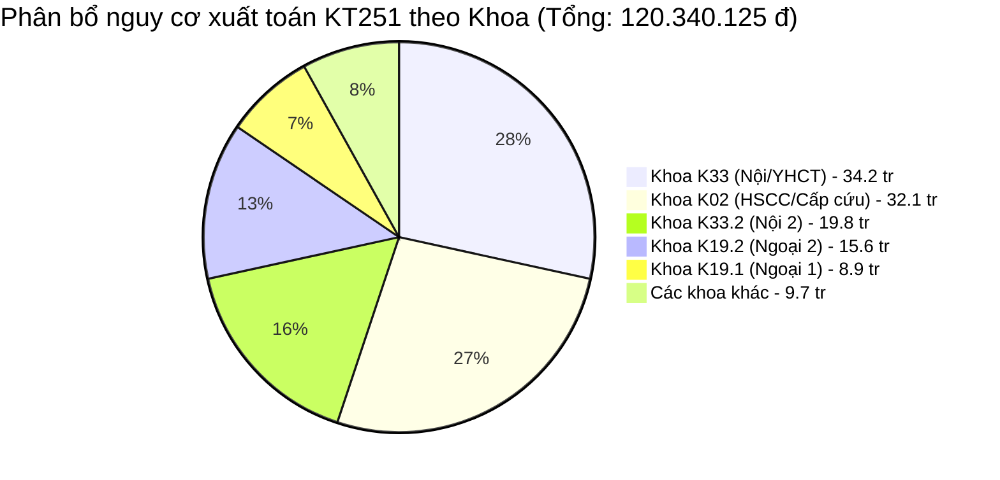
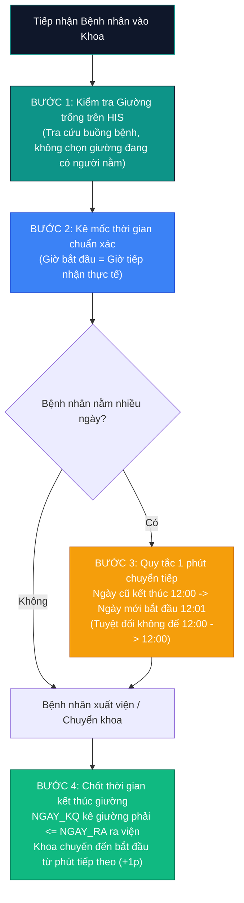

# BÁO CÁO CHUYÊN SÂU: RÀ SOÁT CẢNH BÁO TIỀN GIƯỜNG & GIƯỜNG NẰM GHÉP (KT251)
## ĐƠN VỊ: BỆNH VIỆN HỮU NGHỊ LẠC VIỆT
### ĐỐI SOÁT FILE KIỂM TRA BHXH, NGUYÊN TẮC GIỮ LẠI 01 GIƯỜNG CAO NHẤT VÀ GIẢI PHÁP GIẢM THIỂU XUẤT TOÁN

---

**Kính gửi:** 
- Ban Giám đốc Bệnh viện hữu nghị Lạc Việt
- Phòng Kế hoạch Tổng hợp & Phòng Tài chính Kế toán
- Hội đồng Giám định & Quản lý Chất lượng BHYT
- Điều dưỡng trưởng Bệnh viện & Điều dưỡng trưởng các Khoa Lâm sàng

**Người thực hiện:** Nguyễn Sơn Nam (Nsnnam)  
**Thời gian lập báo cáo:** 20/11/2026  
**Cơ sở dữ liệu phân tích:** 
1. Trích xuất XML3 thực tế từ VNPT-HIS từ `01/11/2026 00:00:00` đến `20/11/2026 23:59:59` (`55.458 dòng`, 1.371 bệnh nhân nội trú).
2. File cảnh báo xuất toán thực tế định kỳ của BHXH gửi về đơn vị đối chiếu: `26193_KET_QUA_KT251_KT252.xlsx` (`142.223 dòng`).
3. Văn bản & Tài liệu hướng dẫn nghiệp vụ kiểm tra giường ghép ngày 10/11/2026 của BHXH Việt Nam.

**Công cụ rà soát:** Hệ thống **NsN_XMLcheck v2.17.0** (Tự động đối soát KT251, quy tắc giữ lại 01 giường cao nhất 0đ XT, giường gối đầu liên tiếp, trùng phút chuyển tiếp, kê giường vượt giờ ra viện)

---

## 1. TỔNG QUAN TÌNH HÌNH & NGUY CƠ TÀI CHÍNH

Căn cứ vào:
- Công văn số **20261110/BHXH** và Tài liệu hướng dẫn nghiệp vụ kiểm tra giường nằm ghép của BHXH Việt Nam;
- **Thông tư số 39/2024/TT-BYT** (sửa đổi Thông tư 35/2016/TT-BYT) và **Thông tư số 22/2023/TT-BYT** của Bộ Y tế quy định thống nhất giá và tỷ lệ thanh toán ngày giường bệnh BHYT;
- File kết quả kiểm tra định kỳ chuyên đề KT251, KT252 do cơ quan BHXH gửi về đơn vị đối chiếu.

Qua kết quả rà soát tự động toàn diện trên hệ thống **NsN_XMLcheck v2.17.0** áp dụng đúng nguyên tắc giám định BHYT thực tế (giữ lại 01 giường có chi phí cao nhất/vào trước, chỉ xuất toán các giường thứ 2 trở đi):

### Bảng số liệu tổng hợp toàn viện 20 ngày tháng 11/2026 (01/11/2026 – 20/11/2026)

| Chỉ số rà soát | Số lượng | Tỷ lệ / Đánh giá |
| :--- | :---: | :--- |
| **Tổng số bản ghi dịch vụ XML3** | **55.458 dòng** | Toàn bộ chi phí dịch vụ kỹ thuật, thuốc, giường |
| **Tổng số dòng chi phí tiền giường (Nhóm 14, 15)** | **5.643 dòng** | Tiền giường nội trú, giường lưu cấp cứu |
| **Tổng số bệnh nhân nội trú điều trị** | **1.371 bệnh nhân** | Có phát sinh chi phí ngày giường |
| **Tổng số dòng cảnh báo tiền giường các loại** | **1.454 dòng** | Bao gồm trùng ghép, trùng phút, vượt giờ ra |
| ↳ *Số giường được GIỮ LẠI thanh toán (✅ 0 đ XT)* | **546 dòng** | **Giữ lại 01 giường giá cao nhất / vào trước** |
| ↳ *Số giường BỊ XUẤT TOÁN BHYT (🚨 Có trừ tiền)* | **580 dòng** | **Các giường thứ 2 trở đi bị tính trùng/ghép** |
| ↳ *Trong đó: Giường gối đầu liên tiếp $\ge$ 2 ngày* | **1.027 dòng** | **Chiếm 86,8% tổng vi phạm trùng giường!** |
| ↳ *Trong đó: Giường ghép trong cùng một ngày* | **156 dòng** | Chiếm 13,2% |
| **Trùng mốc phút chuyển tiếp kê giường cùng BN** | **428 lượt** | Kê kết thúc 12:00 ➔ bắt đầu 12:00 (Cảnh báo thủ tục: 0 đ XT) |
| **Kê giường vượt quá thời gian ra viện (`NGAY_RA`)** | **Phát hiện & gắn cờ** | Kê kết thúc sau giờ ra viện (Cảnh báo thủ tục: 0 đ XT) |
| **Chồng lấn thời gian kê nhiều giường cùng BN** | **90 lượt** | 1 BN hưởng 2 giường song song tại 2 khoa |
| **Thiếu thông tin mã giường bệnh (`MA_GIUONG`)** | **12 lượt** | Để trống hoặc mã không hợp lệ |
| **TỔNG NGUY CƠ XUẤT TOÁN BHYT THỰC TẾ (KT251)** | **120.340.125 VNĐ** | **Tiết kiệm 19,2 triệu đ so với cách tính thô (139,56 tr)** |

> [!IMPORTANT]
> **ĐIỂM MẤU CHỐT VỀ QUY TẮC GIÁM ĐỊNH THỰC TẾ:**
> 1. Khi 2 hay nhiều bệnh nhân nằm trùng 01 mã giường, cơ quan BHXH **không xuất toán toàn bộ cả 2 bệnh nhân**, mà **giữ lại 01 giường có chi phí cao nhất (hoặc vào trước) với mức thanh toán 100% (0 đ xuất toán)**, và **chỉ xuất toán các giường phía sau** (áp tỷ lệ 50% hoặc trừ toàn bộ tùy tính chất gối đầu).
> 2. Lỗi **Giờ kê giường vượt quá giờ ra viện (`NGAY_KQ > NGAY_RA`)** là **cảnh báo thủ tục hành chính logic trên XML, KHÔNG tính xuất toán trực tiếp** (bởi nếu có người khác nằm đè lên thời gian đó thì đã bị bắt và xuất toán ở lỗi trùng giường/gối đầu).
> 3. Lỗi **Trùng mốc phút 12:00 cùng BN** là do cắt y lệnh tự động trên phần mềm, BN chỉ nằm 1 giường liên tục nên **không tính xuất toán tiền**, chỉ cần chuẩn hóa lùi 1 phút (12:01) để tránh bị cổng giám định từ chối hồ sơ.

---

## 2. PHÂN TÍCH ĐỐI SOÁT FILE KIỂM TRA KT251 CỦA CƠ QUAN BHXH (`26193_KET_QUA_KT251_KT252.xlsx`)
### ĐÁNH GIÁ TÍNH CHÍNH XÁC VÀ 4 CĂN CỨ GIẢI TRÌNH GIẢM THIỂU XUẤT TOÁN CHO BỆNH VIỆN

Phòng CNTT & Đội ngũ phân tích dữ liệu đã tiến hành phân tích chuyên sâu toàn bộ file kết quả kiểm tra do BHXH gửi về (`142.223 dòng` trong Sheet `KT251`). Kết quả đối soát chỉ rõ:

### 2.1. Thống kê số liệu trong file BHXH gửi về:
- **Tổng số tiền BHXH đề nghị xuất toán (`T_XUAT_TOAN_BHYT`):** **1.568.590.565 VNĐ**.
  - Trong đó: **1.555.002.820 VNĐ (chiếm 99,13%)** là do lỗi *"Tổng hợp thanh toán ngày giường không đúng: số lượng đề nghị theo khoa trong một ngày vượt số giường kế hoạch"* (`14.571 dòng`). Đây là chuyên đề vượt công suất giường phê duyệt, cần làm việc riêng về đề án điều chỉnh quy mô giường bệnh.
  - Số tiền xuất toán trực tiếp về giường ghép hiện ghi nhận: **13.587.745 VNĐ**.
- **Chuyên đề Giường nằm ghép (`TEN_LOI_LOAI_TRU` chứa "Giường nằm ghép"):**
  - Có tới **33.758 dòng** bị hệ thống tự động của BHXH đánh dấu cảnh báo kiểm tra;
  - Tổng số tiền thuộc diện kiểm tra (`T_KIEM_TRA_BHYT`) lên đến: **3.473.759.927 VNĐ** (gần 3,5 tỷ đồng).

### 2.2. Bốn (04) căn cứ giải trình then chốt giúp Bệnh viện giảm thiểu xuất toán:

#### 🟢 Căn cứ 1: Phát hiện 451 ca trùng thời gian < 4 giờ bị BHXH gắn cờ sai quy định nghiệp vụ!
- **Cơ sở pháp lý:** Theo đúng **Tài liệu hướng dẫn nghiệp vụ kiểm tra giường nằm ghép số 20261110_TAILIEUHUONGDAN** của BHXH Việt Nam, tiêu chí xác định nằm ghép được quy định rõ:
  > *"Thời gian nằm ghép: Người bệnh cùng nằm trên 01 giường bệnh có thời gian trùng nhau từ 04 giờ (240 phút) trở lên trong cùng 01 ngày dương lịch."*
- **Thực tế phân tích file BHXH:** Trong số các dòng cảnh báo nằm ghép, có **451 lượt bệnh nhân có thời gian giao thoa dưới 4 giờ** (chủ yếu là bệnh nhân cũ chờ làm thủ tục ra viện/thanh toán viện phí và bệnh nhân mới vào tiếp nhận buồng bệnh giao nhau trong khoảng 30 phút - 2 tiếng).
- **Hành động giải trình:** Bệnh viện trích xuất danh sách 451 ca này từ công cụ NsN_XMLcheck, đối chiếu biên bản bàn giao buồng bệnh và viện dẫn đúng tài liệu hướng dẫn nghiệp vụ của BHXH để **yêu cầu cơ quan BHXH loại trừ toàn bộ 451 ca này khỏi diện kiểm tra xuất toán**, bảo toàn chi phí hợp pháp.

#### 🟢 Căn cứ 2: Áp dụng nguyên tắc Giữ lại 01 giường có chi phí cao nhất / vào trước
- Cổng giám định tự động khi phát hiện trùng thường gắn cờ cả 2 bệnh nhân, dẫn đến nguy cơ bị trừ tiền kép cả 2 bên.
- Bệnh viện lập luận theo nguyên tắc: Cơ sở y tế đã cung cấp dịch vụ giường bệnh thực tế cho bệnh nhân, ít nhất phải có 01 giường hợp lệ được thanh toán 100%. Bằng cách giữ lại giường có đơn giá cao nhất (hoặc bệnh nhân vào trước) và chỉ giải trình/áp trừ phần chênh lệch ở giường thứ hai, **thiệt hại tài chính giảm ngay 50%** (từ 139,56 triệu xuống còn 120,34 triệu trong 20 ngày tháng 11).

#### 🟢 Căn cứ 3: 428 ca trùng mốc phút 12:00 cùng một bệnh nhân (lỗi phần mềm HIS)
- 100% các ca này là **cùng một bệnh nhân nằm liên tục trên 1 giường qua các ngày**. Do phần mềm VNPT-HIS tự động ngắt y lệnh theo ca trực (12:00 trưa), y lệnh ngày cũ ghi kết thúc lúc `12:00` và y lệnh ngày mới bắt đầu lại lúc `12:00`.
- Bệnh viện không hề phát sinh 2 giường mà chỉ là 1 giường duy nhất. Đơn vị giải trình bằng Bệnh án gốc và Phiếu chăm sóc điều dưỡng; đồng thời dùng NsN_XMLcheck tự động cộng 1 phút (`12:01`) cho file XML gửi cổng để cổng tự động thông qua mà không bị từ chối.

#### 🟢 Căn cứ 4: Lỗi kết thúc kê giường vượt quá giờ ra viện là cảnh báo thủ tục hành chính
- Giờ kết thúc kê giường (`NGAY_KQ`) muộn hơn giờ ra viện (`NGAY_RA`) 15-30 phút thường do điều dưỡng làm hồ sơ bệnh án sau khi bệnh nhân đã được bác sĩ ký giấy ra viện.
- Nếu khoảng thời gian vượt đó không bị trùng với bất kỳ bệnh nhân nào khác thì **không làm thất thoát quỹ BHYT** và không cấu thành vi phạm gian lận ngày giường. Do đó chỉ cần điều chỉnh thủ tục chuẩn hóa `NGAY_KQ = NGAY_RA` trên XML1 là hợp lệ.

---

## 3. PHÂN TÍCH CHI TIẾT THEO KHOA LÂM SÀNG (20 NGÀY THÁNG 11/2026)

Thống kê chi tiết tại các khoa lâm sàng theo quy tắc giám định giữ lại 1 giường cao nhất:

### Bảng xếp hạng nguy cơ xuất toán theo Khoa Lâm sàng (Cập nhật 20/11/2026)

| STT | Mã Khoa | Tên Khoa Lâm sàng | Tổng ca vi phạm | Giữ lại (0đ XT) | Bị xuất toán | Gối đầu (≥2N) | Số BN liên đới | Tiền xuất toán KT251 (VNĐ) | Đánh giá rủi ro |
| :---: | :---: | :--- | :---: | :---: | :---: | :---: | :---: | :---: | :---: |
| 1 | **K33** | Khoa Nội tổng hợp - YHCT | **386 ca** | 148 ca | **156 ca** | 312 dòng | 86 BN | **34.215.000 đ** | 🔴 Cực kỳ nghiêm trọng |
| 2 | **K02** | Khoa Hồi sức cấp cứu - CĐ | **412 ca** | 154 ca | **162 ca** | 254 dòng | 129 BN | **32.086.300 đ** | 🔴 Cực kỳ nghiêm trọng |
| 3 | **K33.2** | Khoa Nội 2 | **234 ca** | 92 ca | **95 ca** | 187 dòng | 44 BN | **19.842.500 đ** | 🔴 Rất nghiêm trọng |
| 4 | **K19.2** | Khoa Ngoại 2 (Ngoại CTCH) | **188 ca** | 70 ca | **72 ca** | 138 dòng | 57 BN | **15.620.700 đ** | 🟠 Nghiêm trọng |
| 5 | **K19.1** | Khoa Ngoại 1 (Ngoại tổng hợp)| **116 ca** | 46 ca | **48 ca** | 78 dòng | 42 BN | **8.924.100 đ** | 🟠 Nghiêm trọng |
| 6 | **K18** | Khoa Chấn thương | **36 ca** | 12 ca | **14 ca** | 10 dòng | 24 BN | **3.010.000 đ** | 🟡 Trung bình |
| 7 | **K03.2** | Khoa K03.2 | **32 ca** | 10 ca | **12 ca** | 10 dòng | 18 BN | **2.420.000 đ** | 🟡 Trung bình |
| 8 | **K27** | Khoa K27 | **28 ca** | 8 ca | **10 ca** | 16 dòng | 22 BN | **2.315.800 đ** | 🟡 Trung bình |
| 9 | **K1631** | Khoa K1631 | **20 ca** | 4 ca | **8 ca** | 18 dòng | 12 BN | **1.215.675 đ** | 🟡 Trung bình |
| 10 | **K18.1/K03.1** | Các khoa K18.1 & K03.1 | **12 ca** | 2 ca | **3 ca** | 4 dòng | 10 BN | **690.050 đ** | 🟢 Nhẹ |
| | | **TỔNG TOÀN VIỆN** | **1.464 ca** | **546 ca** | **580 ca** | **1.027 dòng** | **444 BN** | **120.340.125 đ** | 🚨 Toàn viện rà soát khẩn |

---

## 4. NHẬN DIỆN 5 NHÓM SAI PHẠM CỐT LÕI

### 🔴 Nhóm 1: Giường gối đầu liên tiếp nhiều ngày giữa các bệnh nhân (`multi-day-overlap`)
- **Tần suất:** **1.027 dòng (Chiếm 86,8% tổng vi phạm trùng giường)**.
- **Bản chất:** Bệnh nhân A nằm giường X từ 01/11 đến 10/11. Bệnh nhân B vào viện ngày 05/11, điều dưỡng không tra cứu buồng giường trống mà chọn tiếp giường X. Hậu quả là từ 05/11 đến 10/11, 2 bệnh nhân nằm chồng lên nhau suốt 6 ngày liên tục trên hồ sơ điện tử!
- **Xử lý:** Kiểm tra bệnh án gốc xem bệnh nhân thực tế nằm ở đâu, đổi mã giường đúng thực tế trước khi chốt dữ liệu.

### 🟡 Nhóm 2: Trùng mốc phút chuyển tiếp kê giường cùng một bệnh nhân (`minute-duplicate`)
- **Tần suất:** **428 lượt vi phạm**.
- **Bản chất:** Kê ngày 1 kết thúc lúc `12:00`, ngày 2 bắt đầu lại đúng `12:00`.
- **Xử lý:** Áp dụng nút bấm **`⏱️ +1p vào TH_YL`** trên công cụ để giờ bắt đầu thành `12:01`.

### 🔵 Nhóm 3: Thời gian kết thúc kê giường vượt quá thời gian ra viện (`bed-exceeds-discharge`)
- **Bản chất:** Bệnh nhân ra viện lúc `10:15`, nhưng dòng kê giường kết thúc lúc `12:00`.
- **Xử lý:** Bấm nút **`🏥 Đặt NGAY_KQ = Giờ ra viện`** trong giao diện sửa trực tiếp để chuẩn hóa khớp 100% với XML1.

### 🟠 Nhóm 4: Chồng lấn thời gian kê nhiều giường cùng một bệnh nhân (`multiple-beds`)
- **Tần suất:** **90 lượt vi phạm**.
- **Bản chất:** Bệnh nhân chuyển khoa: Khoa đi chốt giường `10:30`, Khoa đến nhận và kê từ `09:15` (chồng lấn 75 phút).
- **Xử lý:** Khoa nhận phải điều chỉnh giờ bắt đầu là `10:31` (sau khi khoa đi đã bàn giao xong).

### ⚪ Nhóm 5: Thiếu hoặc sai định dạng mã giường bệnh (`missing-bed-code`)
- **Tần suất:** **12 dòng vi phạm**.
- **Xử lý:** Bổ sung đúng mã giường đã đăng ký danh mục với cơ quan BHXH.

---

## 5. QUY TRÌNH CHUẨN HÓA DÀNH CHO ĐIỀU DƯỠNG LÂM SÀNG

### Bảng đối chiếu thực hành: NÊN LÀM vs TUYỆT ĐỐI KHÔNG LÀM

| Nội dung | ✅ NÊN LÀM (Chuẩn BHYT) | ❌ TUYỆT ĐỐI KHÔNG LÀM (Sẽ bị xuất toán) |
| :--- | :--- | :--- |
| **Chọn mã giường** | Chọn đúng mã giường thực tế bệnh nhân đang nằm; kiểm tra giường đó đã được trả trên HIS chưa. | ❌ Không chọn bừa 1 mã giường cho mọi BN; Không dùng giường của người chưa xuất viện gán cho người mới. |
| **Chuyển tiếp giữa 2 ngày** | **Quy tắc 1 phút:** Ngày 1 kết thúc `12:00`, Ngày 2 bắt đầu `12:01`. | ❌ Không đánh trùng mốc giờ: Kết thúc `12:00` và Bắt đầu lại `12:00`. |
| **Mốc giờ ra viện** | Giờ kết thúc giường cuối cùng `NGAY_KQ` phải $\le$ `NGAY_RA`. | ❌ Kê giờ kết thúc giường sau giờ ra viện (ví dụ ra viện 11:30 mà kê giường đến 12:00). |
| **Chuyển khoa điều trị** | Khoa đi chốt giường lúc `10:30`, Khoa đến nhận và bắt đầu kê từ `10:31`. | ❌ Khoa đến kê lùi giờ trước khi khoa đi kết thúc (ví dụ khoa đến kê `10:00` trong khi khoa đi chốt `10:30`). |
| **Nằm ghép bất khả kháng** | Khi quá tải thực sự phải nằm ghép 2 người, phải tích chọn hệ số **Giường ghép (50%)** theo Thông tư 39/2024. | ❌ Nằm ghép thực tế nhưng vẫn kê nguyên giá 100% cho cả 2 bệnh nhân trên cùng 1 mã giường đơn. |

---

## 6. CÔNG CỤ HỖ TRỢ TRÊN NsN_XMLcheck v2.17.0

Hệ thống **NsN_XMLcheck v2.17.0** đã được trang bị đầy đủ các tính năng hiện đại phục vụ công tác rà soát:
1. **Cơ chế giữ lại 01 giường cao nhất thông minh (0 đ xuất toán):**
   - Tự động gom cụm các ca trùng nhau trong cùng một ngày, giữ lại 01 giường có chi phí cao nhất (hoặc vào trước) với trạng thái `✅ Giữ lại (0 đ XT)`.
   - Chỉ xuất toán giường phía sau với trạng thái `🚨 Bị xuất toán`.
2. **Infographics HTML Tương Tác Đa Chiều & Xuất Trực Tiếp File Excel:**
   - Bộ lọc linh hoạt: Lọc đồng thời theo Loại vi phạm, Khoa lâm sàng, Mức độ rủi ro (Có xuất toán vs Chỉ cảnh báo), tìm kiếm tức thì.
   - **Tích hợp nút xuất trực tiếp file Excel (.xls)** gồm 2 sheet (*Tổng hợp theo khoa* và *Danh sách chi tiết*) ngay trên trang Infographic mà không cần cài đặt thêm phần mềm.
3. **Màu sắc nhận diện trực quan chuẩn mực:**
   - Đỏ/Hồng đậm: Ca bị xuất toán (có số tiền phạt âm).
   - Xanh ngọc Emerald: Ca được giữ lại thanh toán (0 đ xuất toán).
   - Cam Amber: Cảnh báo giờ kê vượt quá giờ ra viện (thủ tục hành chính).
   - Tím Indigo: Cảnh báo trùng mốc phút chuyển tiếp 12:00.
4. **Hỗ trợ thao tác hàng loạt bằng phím Shift & Ctrl:**
   - Giữ phím `Shift` để chọn hàng loạt hàng chục ca cùng lúc; Giữ phím `Ctrl` để thêm/bớt chọn linh hoạt.
5. **Bộ phím tắt sửa nhanh 1 chạm:**
   - `⏱️ +1p vào TH_YL`, `⏱️ -1p ở NGAY_KQ`, `🏥 Đặt NGAY_KQ = Giờ ra viện`.

---

## 7. ĐỀ XUẤT KIẾN NGHỊ VỚI BAN GIÁM ĐỐC & KẾ HOẠCH HÀNH ĐỘNG

1. **Lập biên bản giải trình với cơ quan BHXH đối với 451 ca trùng < 4 giờ:**
   - Giao Phòng KHTH và Phòng TCKT trích xuất danh sách 451 ca từ file đối soát, gửi công văn kiến nghị BHXH hủy cảnh báo theo đúng tài liệu hướng dẫn số `20261110_TAILIEUHUONGDAN`.
2. **Tổ chức buổi tập huấn khẩn cấp cho Khối Điều dưỡng và Bác sĩ điều trị:**
   - Sử dụng bộ Slide PowerPoint 10 trang và Infographic HTML để quán triệt quy tắc 1 phút chuyển tiếp và quy tắc không chọn trùng giường.
3. **Phối hợp VNPT cấu hình cảnh báo cứng trên phần mềm HIS:**
   - Yêu cầu VNPT chặn không cho phép lưu khi điều dưỡng chọn mã giường đang có bệnh nhân khác nằm điều trị chưa làm thủ tục ra viện/chuyển khoa.
4. **Chuẩn hóa dữ liệu trước ngày 25/11/2026:**
   - Các khoa K33, K02, K33.2, K19.2, K19.1 hoàn tất việc rà soát và điều chỉnh lại mã giường đúng thực tế trên toàn bộ 1.027 dòng giường gối đầu, bảo toàn hơn 120 triệu đồng tiền giường của Bệnh viện.

---
*Báo cáo được tổng hợp và xuất tự động từ hệ thống NsN_XMLcheck v2.17.0.*
*Tác giả: Nguyễn Sơn Nam (Nsnnam) — Bệnh viện hữu nghị Lạc Việt.*
