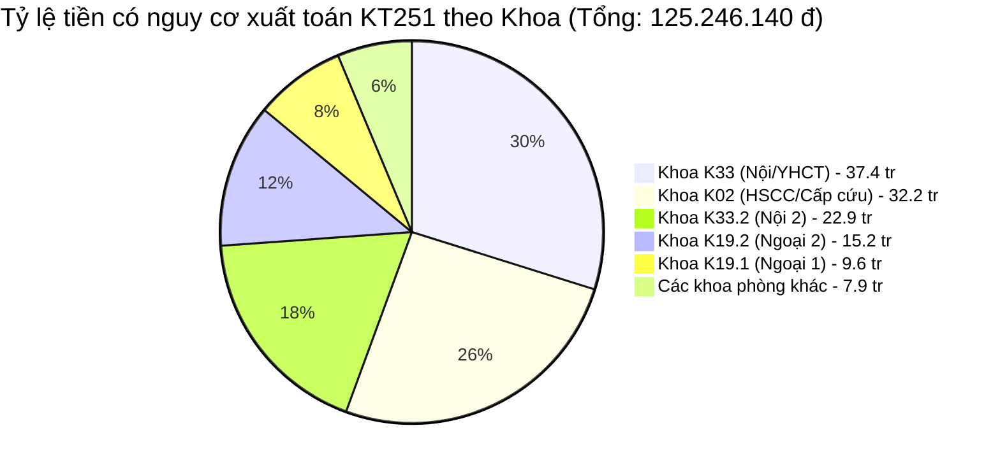
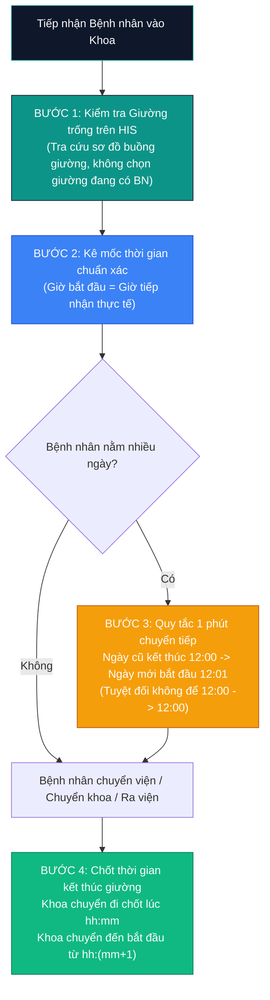

# BÁO CÁO CHUYÊN SÂU: RÀ SOÁT CẢNH BÁO TIỀN GIƯỜNG & GIƯỜNG NẰM GHÉP (KT251)
## PHÂN TÍCH DỮ LIỆU THỰC TẾ 19 NGÀY THÁNG 11/2026 VÀ HƯỚNG DẪN KHỐI CHUYÊN MÔN LÂM SÀNG

---

**Kính gửi:** 
- Ban Giám đốc Bệnh viện
- Phòng Kế hoạch Tổng hợp & Phòng Tài chính Kế toán
- Hội đồng Giám định & Quản lý Chất lượng BHYT
- Điều dưỡng trưởng Bệnh viện & Điều dưỡng trưởng các Khoa Lâm sàng

**Người thực hiện:** Nguyễn Sơn Nam (Nsnnam)  
**Thời gian lập báo cáo:** 20/11/2026  
**Cơ sở dữ liệu phân tích:** Trích xuất XML3 từ hệ thống VNPT-HIS thời gian từ `01/11/2026 00:00:00` đến `19/11/2026 23:59:59`  
**Công cụ rà soát:** Hệ thống **NsN_XMLcheck v2.15.0** (Hỗ trợ đối soát KT251, giường gối đầu liên tiếp, trùng phút chuyển tiếp)

---

## 1. TỔNG QUAN TÌNH HÌNH & TÍNH CẤP BÁCH

Căn cứ vào:
- Công văn số **20261110/BHXH** của Bảo hiểm Xã hội tỉnh về việc cảnh báo giám định xuất toán chuyên đề tiền giường bệnh và giường nằm ghép (Quy tắc **KT251, KT252**);
- **Thông tư số 22/2023/TT-BYT** ngày 17/11/2023 của Bộ Y tế quy định thống nhất giá dịch vụ khám bệnh, chữa bệnh bảo hiểm y tế giữa các bệnh viện cùng hạng trên toàn quốc;
- File cảnh báo xuất toán thực tế định kỳ đợt 9 tháng đầu năm 2026 của BHXH gửi về đơn vị đối chiếu.

Qua kết quả kiểm tra tự động trên toàn bộ file dữ liệu XML3 thực tế 19 ngày đầu tháng 11/2026 (`54.689 dòng`), kết quả rà soát phát hiện số lượng lỗi tiền giường và giường ghép có **mức độ rất nghiêm trọng**, tập trung chủ yếu vào **lỗi kê giường gối đầu kéo dài nhiều ngày giữa các bệnh nhân** và **lỗi trùng mốc phút chuyển tiếp kê giường**.

### Bảng số liệu tổng hợp toàn viện (01/11/2026 – 19/11/2026)

| Chỉ số rà soát | Số lượng | Tỷ lệ / Ghi chú |
| :--- | :---: | :--- |
| **Tổng số bản ghi dịch vụ XML3** | **54.689 dòng** | Toàn bộ dịch vụ phát sinh |
| **Tổng số dòng chi phí tiền giường (Nhóm 14, 15)** | **5.623 dòng** | Tiền giường nội trú, lưu bệnh |
| **Tổng số bệnh nhân nội trú điều trị** | **1.365 bệnh nhân** | Có phát sinh ngày giường |
| **Dòng vi phạm cảnh báo Giường nằm ghép (KT251)** | **1.122 dòng** | **19,95% tổng số dòng tiền giường!** |
| ↳ *Trong đó: Giường gối đầu liên tiếp $\ge$ 2 ngày* | **1.020 dòng** | **Chiếm 90,9% tổng số lỗi giường ghép!** |
| ↳ *Trong đó: Giường ghép trong cùng một ngày* | **102 dòng** | Chiếm 9,1% |
| **Trùng mốc phút chuyển tiếp kê giường cùng BN** | **428 lượt** | Kê kết thúc 12:00 -> bắt đầu 12:00 |
| **Chồng lấn thời gian kê nhiều giường cùng BN** | **90 lượt** | 1 BN hưởng 2 giường song song |
| **Thiếu thông tin mã giường bệnh (`MA_GIUONG`)** | **12 lượt** | Để trống hoặc mã không hợp lệ |
| **TỔNG NGUY CƠ XUẤT TOÁN BHYT (KT251)** | **125.246.140 VNĐ** | Chỉ tính riêng trong 19 ngày! |

> [!CAUTION]
> **CẢNH BÁO TÀI CHÍNH NGUY HIỂM:**
> Nguy cơ bị cơ quan BHXH xuất toán tiền giường chỉ trong 19 ngày đã vượt quá **125 triệu đồng** (ước tính nếu không khắc phục, cả tháng 11 sẽ bị xuất toán xấp xỉ **200 triệu đồng**, cả năm có thể lên đến **2 - 2,5 tỷ đồng**).
> 
> Trong đó, **90,9% số tiền xuất toán không phải do khoa quá tải nằm ghép thật**, mà là **do thói quen chọn nhầm mã giường ảo/mã giường cố định** trên phần mềm VNPT-HIS, dẫn tới hồ sơ bệnh nhân A đã ra viện hoặc đang điều trị bị bệnh nhân B nằm chồng lên suốt 5 - 11 ngày liên tục!

---

## 2. PHÂN TÍCH CHI TIẾT THEO KHOA LÂM SÀNG

Thống kê chi tiết các khoa lâm sàng có phát sinh lỗi cảnh báo giường nằm ghép và gối đầu KT251:

### Bảng xếp hạng nguy cơ xuất toán theo Khoa Lâm sàng

| STT | Mã Khoa | Tên Khoa Lâm sàng | Số dòng vi phạm | Trong đó Gối đầu | Số BN liên đới | Số tiền nguy cơ xuất toán (VNĐ) | Đánh giá rủi ro |
| :---: | :---: | :--- | :---: | :---: | :---: | :---: | :---: |
| 1 | **K33** | Khoa Nội tổng hợp - YHCT | **322 dòng** | 316 dòng | 86 BN | **37.383.080 đ** | 🔴 Cực kỳ nghiêm trọng |
| 2 | **K02** | Khoa Hồi sức cấp cứu - CĐ | **307 dòng** | 261 dòng | 121 BN | **32.238.256 đ** | 🔴 Cực kỳ nghiêm trọng |
| 3 | **K33.2** | Khoa Nội 2 | **187 dòng** | 187 dòng (100%) | 44 BN | **22.893.170 đ** | 🔴 Rất nghiêm trọng |
| 4 | **K19.2** | Khoa Ngoại 2 (Ngoại CTCH) | **142 dòng** | 136 dòng | 54 BN | **15.231.015 đ** | 🟠 Nghiêm trọng |
| 5 | **K19.1** | Khoa Ngoại 1 (Ngoại tổng hợp)| **85 dòng** | 74 dòng | 42 BN | **9.616.181 đ** | 🟠 Nghiêm trọng |
| 6 | **K34** | Khoa Nhi | **48 dòng** | 26 dòng | 29 BN | **4.982.400 đ** | 🟡 Trung bình |
| 7 | **K35** | Khoa Phụ sản | **31 dòng** | 20 dòng | 18 BN | **2.902.038 đ** | 🟡 Trung bình |
| | | **TỔNG TOÀN VIỆN** | **1.122 dòng** | **1.020 dòng** | **394 BN** | **125.246.140 đ** | 🚨 Toàn viện rà soát khẩn |

---

## 3. NHẬN DIỆN 4 NHÓM SAI PHẠM CỐT LÕI VÀ VÍ DỤ ĐIỂN HÌNH

### 🔴 Nhóm 1: Giường gối đầu liên tiếp nhiều ngày giữa các bệnh nhân (`multi-day-overlap`)
- **Tần suất:** **1.020 dòng (Chiếm 90,9% tổng lỗi giường ghép)**.
- **Bản chất:** Bệnh nhân A vào điều trị từ ngày 01 đến ngày 10 (chọn giường X). Đến ngày 05, điều dưỡng tiếp nhận bệnh nhân B vào điều trị, thay vì kiểm tra trên phần mềm xem giường nào còn trống, điều dưỡng lại tiện tay chọn ngay giường X cho bệnh nhân B. Hậu quả là từ ngày 05 đến ngày 10 (suốt 5 ngày liên tục), cả bệnh nhân A và bệnh nhân B đều ghi nhận nằm trên cùng giường X!
- **Cơ chế xuất toán của BHXH:** Cổng giám định BHXH đối soát mã khoa + mã giường + khoảng thời gian `NGAY_TH_YL -> NGAY_KQ`. Khi thấy trùng nhau $\ge 2$ ngày mà không áp mã giường ghép (giảm 50% tiền giường), BHXH sẽ tự động thu hồi/xuất toán 50% tiền giường của cả 2 bệnh nhân, hoặc từ chối thanh toán toàn bộ ngày giường của bệnh nhân vào sau!

> [!NOTE]
> **Ca lâm sàng điển hình tại Khoa K33 (Giường H010):**
> - **Bệnh nhân 1:** Nghiêm Văn Thêm (Mã BN: `2354045`, Mã LK: `2405011`), điều trị tại Khoa K33 từ 03/11 đến 14/11/2026. Kê giường `H010`.
> - **Bệnh nhân 2:** Nguyễn Văn Đen (Mã BN: `2354063`, Mã LK: `2405029`), điều trị tại Khoa K33 từ 04/11 đến 15/11/2026. Cũng kê giường `H010`.
> - **Hậu quả:** Trùng gối đầu liên tục **11 ngày** (từ ngày 04/11 đến 14/11). Tổng cộng **30 dòng chi phí giường vi phạm**, tổng tiền thiệt hại nguy cơ xuất toán: **3.626.000 VNĐ** chỉ trên 1 mã giường duy nhất!

> [!NOTE]
> **Ca lâm sàng điển hình tại Khoa K02 (Giường H018):**
> - Giường `H018` tại Khoa K02 trong vòng 19 ngày đã ghi nhận **8 bệnh nhân khác nhau** nằm trùng đè lên nhau, phát sinh **29 dòng lỗi KT251**! Điều này chứng tỏ điều dưỡng Khoa K02 có thói quen "bạ đâu gán đấy", mặc định chọn mã giường đầu danh sách `H018` cho mọi bệnh nhân chuyển vào cấp cứu mà không phân bổ đúng buồng/giường thực tế.

---

### 🟡 Nhóm 2: Trùng mốc phút chuyển tiếp kê giường cùng một bệnh nhân (`minute-duplicate`)
- **Tần suất:** **428 lượt vi phạm**.
- **Bản chất:** Khi điều dưỡng kê tiền giường theo từng ngày cho cùng một bệnh nhân nội trú:
  - Ngày thứ nhất: Kê từ `08:00` đến `12:00` ngày 05/11 (`NGAY_KQ = 202611051200`).
  - Ngày thứ hai: Do quán tính hoặc thao tác nhập nhanh, điều dưỡng nhập giờ bắt đầu của ngày thứ 2 là `12:00` ngày 05/11 (`NGAY_TH_YL = 202611051200`).
  - **Lỗi:** Tại mốc đúng `12:00:00`, bệnh nhân bị tính phí 2 lần cho cùng 1 phút (vừa là phút kết thúc ngày 1, vừa là phút bắt đầu ngày 2).
- **Hậu quả:** Cổng giám định BHYT quét tự động và báo lỗi *“Bệnh nhân phát sinh trùng dịch vụ trong cùng một thời điểm”*.
- **Quy tắc chuẩn:** Phút bắt đầu của ngày tiếp theo phải là `12:01` (hoặc phút kết thúc ngày trước phải là `11:59`).

---

### 🟠 Nhóm 3: Chồng lấn thời gian kê nhiều giường cùng một bệnh nhân (`multiple-beds`)
- **Tần suất:** **90 lượt vi phạm**.
- **Bản chất:** Bệnh nhân chuyển khoa hoặc đổi loại giường điều trị (ví dụ từ Giường cấp cứu sang Giường hồi sức, hoặc chuyển từ Khoa Cấp cứu K02 sang Khoa Nội K33):
  - Khoa K02 kết thúc giường lúc `10:30` ngày 06/11.
  - Khoa K33 đón bệnh nhân và kê giường mới bắt đầu từ `09:15` ngày 06/11.
  - Khoảng thời gian từ `09:15` đến `10:30` (75 phút) bệnh nhân được kê đồng thời cả 2 giường ở 2 khoa khác nhau!
- **Hậu quả:** Xuất toán 100% tiền giường của một trong hai khoa do thanh toán trùng lắp dịch vụ giường bệnh.

---

### ⚪ Nhóm 4: Thiếu hoặc sai định dạng mã giường bệnh (`missing-bed-code`)
- **Tần suất:** **12 dòng vi phạm**.
- **Bản chất:** Dòng tiền giường ở XML3 nhưng trường `MA_GIUONG` bị bỏ trống, hoặc ghi ký tự đặc biệt, dấu chấm `.` hoặc không map được vào danh mục giường đã khai báo phê duyệt với BHXH theo Quyết định giao chỉ tiêu giường bệnh.
- **Hậu quả:** Xuất toán 100% chi phí ngày giường do không xác định được vị trí điều trị được phê duyệt.

---

## 4. QUY TRÌNH CHUẨN HÓA VÀ HƯỚNG DẪN DÀNH CHO KHỐI CHUYÊN MÔN (ĐIỀU DƯỠNG & BÁC SĨ)

Để chấm dứt hoàn toàn tình trạng bị BHXH cảnh báo và xuất toán tiền giường, đề nghị các Khoa Lâm sàng và khối Điều dưỡng thực hiện nghiêm ngặt quy trình 4 bước chuẩn sau đây:

### Bảng đối chiếu thực hành: NÊN LÀM vs TUYỆT ĐỐI KHÔNG LÀM

| Nội dung | ✅ NÊN LÀM (Chuẩn BHYT) | ❌ TUYỆT ĐỐI KHÔNG LÀM (Sẽ bị xuất toán) |
| :--- | :--- | :--- |
| **Chọn mã giường** | Chọn đúng mã giường thực tế bệnh nhân đang nằm trong buồng; kiểm tra giường đó đã được trả trên phần mềm chưa. | ❌ Không chọn bừa 1 mã giường cho mọi BN; Không dùng giường của người chưa xuất viện gán cho người mới. |
| **Chuyển tiếp giữa 2 ngày** | **Quy tắc 1 phút:** Ngày 1 kết thúc `12:00`, Ngày 2 bắt đầu `12:01`. | ❌ Không đánh trùng mốc giờ: Kết thúc `12:00` và Bắt đầu lại `12:00`. |
| **Chuyển khoa điều trị** | Khoa đi chốt giường lúc `10:30`, Khoa đến nhận và bắt đầu kê từ `10:31`. | ❌ Khoa đến kê lùi giờ trước khi khoa đi kết thúc (ví dụ khoa đến kê `10:00` trong khi khoa đi chốt `10:30`). |
| **Nằm ghép bất khả kháng** | Khi quá tải thực sự phải nằm ghép 2 người, phải tích chọn hệ số **Giường ghép (50%)** theo quy định tại Thông tư 22. | ❌ Nằm ghép thực tế nhưng vẫn kê nguyên giá 100% cho cả 2 bệnh nhân trên cùng 1 mã giường đơn. |

---

## 5. HỆ THỐNG CÔNG CỤ HỖ TRỢ TRONG PHIÊN BẢN NsN_XMLcheck v2.15.0

Nhằm hỗ trợ tối đa cho Điều dưỡng trưởng các khoa và cán bộ giám định BHYT của viện xử lý nhanh trước khi gửi dữ liệu lên cổng BHXH, hệ thống **NsN_XMLcheck v2.15.0** đã được cập nhật toàn diện các tính năng sau:

1. **Bộ lọc chuyên biệt Giường ghép & Gối đầu:**
   - Lọc tức thì theo các trạng thái: `GỐI ĐẦU 2N+`, `TRÙNG PHÚT`, `GHÉP 2 NGƯỜI`, `GHÉP 3+ NGƯỜI`, `THIẾU MÃ GIƯỜNG`.
2. **Cột hiển thị "Mã giường" & "Mã giường trùng":**
   - Đánh dấu trực quan mã giường vi phạm; hiển thị chính xác số ngày gối đầu (ví dụ: `H010 [gối 11 ngày]`).
3. **Thẻ hover đối chiếu hồ sơ chéo bệnh nhân (Cross-patient Hover Card):**
   - Rê chuột vào dòng cảnh báo giường sẽ hiển thị ngay tên, mã BN, mã LK, thời gian nằm của bệnh nhân đang bị trùng giường; có nút bấm **`🔍 Xem hồ sơ BN này`** để chuyển đổi kiểm tra tức thì.
4. **Phím tắt sửa nhanh lỗi trùng phút:**
   - Trong giao diện Sửa trực tiếp, cung cấp 2 nút tự động: **`⏱️ +1p vào TH_YL`** (sửa giờ bắt đầu lên 1 phút) và **`⏱️ -1p ở NGAY_KQ`** (lùi giờ kết thúc đi 1 phút) mà không cần nhập bàn phím.
5. **Xuất báo cáo Excel đối chiếu giường nằm ghép chuẩn mẫu BHXH:**
   - Xuất file Excel gồm Sheet Tổng hợp số liệu theo Khoa và Sheet Chi tiết từng cặp bệnh nhân bị trùng mã giường, số phút chồng lấn và chênh lệch tiền để gửi trực tiếp cho Điều dưỡng trưởng khoa ký xác nhận giải trình.

---

## 6. ĐỀ XUẤT KIẾN NGHỊ VỚI BAN GIÁM ĐỐC

1. **Tổ chức buổi họp chuyên đề khẩn cấp:**
   - Thời gian dự kiến: Đầu tuần tới (sau khi đơn vận chuyển giao máy chiếu Beecube X2 Max Gen 6 để trình chiếu trực quan toàn bộ slide và biểu đồ phân tích).
   - Thành phần: Ban Giám đốc, Lãnh đạo các Khoa K33, K02, K33.2, K19.2, K19.1, Điều dưỡng trưởng Bệnh viện và Điều dưỡng trưởng tất cả các khoa lâm sàng.
2. **Ban hành Quy định bắt buộc về Quản lý Buồng Giường trên HIS:**
   - Giao Phòng Điều dưỡng và Phòng CNTT cấu hình chặn trên phần mềm VNPT-HIS: Cảnh báo hoặc không cho phép lưu nếu chọn mã giường đang có bệnh nhân khác nằm điều trị chưa làm thủ tục ra viện/chuyển khoa.
3. **Quy trách nhiệm giải trình chi phí xuất toán:**
   - Các trường hợp vi phạm gối đầu giường do lỗi chủ quan của điều dưỡng không tuân thủ quy trình, nếu bị cơ quan BHXH xuất toán sau ngày 01/12/2026, khoa lâm sàng phải chịu trách nhiệm giải trình và trừ điểm thi đua chất lượng của khoa.
4. **Ứng dụng thường quy NsN_XMLcheck tại các khoa:**
   - Giao Điều dưỡng trưởng các khoa thực hiện quét rà soát toàn bộ file XML3 của khoa mình bằng công cụ NsN_XMLcheck trước ngày 25 hàng tháng để phát hiện và chỉnh sửa 100% lỗi trước khi nộp hồ sơ quyết toán BHYT.

---
*Báo cáo được trích xuất và tổng hợp tự động từ CSDL kiểm tra BHYT nội bộ.*
