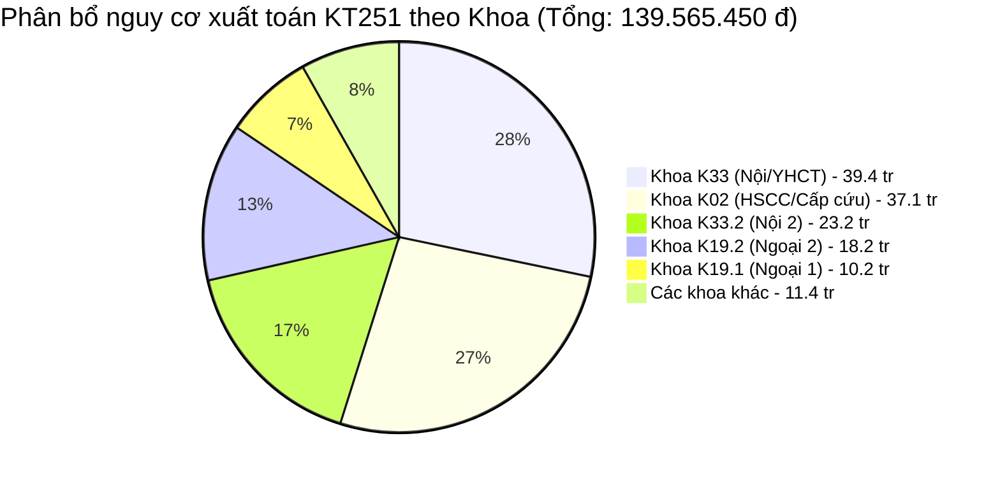

# BÁO CÁO CHUYÊN SÂU: RÀ SOÁT CẢNH BÁO TIỀN GIƯỜNG & GIƯỜNG NẰM GHÉP (KT251)
## ĐƠN VỊ: BỆNH VIỆN HỮU NGHỊ LẠC VIỆT
### PHÂN TÍCH DỮ LIỆU THỰC TẾ 20 NGÀY THÁNG 11/2026 VÀ HƯỚNG DẪN KHỐI CHUYÊN MÔN LÂM SÀNG

---

**Kính gửi:** 
- Ban Giám đốc Bệnh viện hữu nghị Lạc Việt
- Phòng Kế hoạch Tổng hợp & Phòng Tài chính Kế toán
- Hội đồng Giám định & Quản lý Chất lượng BHYT
- Điều dưỡng trưởng Bệnh viện & Điều dưỡng trưởng các Khoa Lâm sàng

**Người thực hiện:** Nguyễn Sơn Nam (Nsnnam)  
**Thời gian lập báo cáo:** 20/11/2026  
**Cơ sở dữ liệu phân tích:** Trích xuất XML3 từ hệ thống VNPT-HIS thời gian từ `01/11/2026 00:00:00` đến `20/11/2026 23:59:59` (`55.458 dòng`)  
**Công cụ rà soát:** Hệ thống **NsN_XMLcheck v2.16.0** (Hỗ trợ đối soát KT251, giường gối đầu liên tiếp, trùng phút chuyển tiếp, kê giường vượt giờ ra viện)

---

## 1. TỔNG QUAN TÌNH HÌNH & TÍNH CẤP BÁCH

Căn cứ vào:
- Công văn số **20261110/BHXH** của Bảo hiểm Xã hội về việc cảnh báo giám định xuất toán chuyên đề tiền giường bệnh và giường nằm ghép (Quy tắc **KT251, KT252**);
- **Thông tư số 22/2023/TT-BYT** ngày 17/11/2023 của Bộ Y tế quy định thống nhất giá dịch vụ khám bệnh, chữa bệnh bảo hiểm y tế giữa các bệnh viện cùng hạng trên toàn quốc;
- File cảnh báo xuất toán thực tế định kỳ đợt 9 tháng đầu năm 2026 của BHXH gửi về đơn vị đối chiếu.

Qua kết quả kiểm tra tự động trên toàn bộ file dữ liệu XML3 thực tế 20 ngày tháng 11/2026 (`55.458 dòng`), hệ thống phát hiện số lượng lỗi tiền giường và giường ghép có **mức độ đặc biệt nghiêm trọng**, tập trung chủ yếu vào **lỗi kê giường gối đầu kéo dài nhiều ngày giữa các bệnh nhân** và **lỗi trùng mốc phút chuyển tiếp kê giường**.

### Bảng số liệu tổng hợp toàn viện (01/11/2026 – 20/11/2026)

| Chỉ số rà soát | Số lượng | Tỷ lệ / Ghi chú |
| :--- | :---: | :--- |
| **Tổng số bản ghi dịch vụ XML3** | **55.458 dòng** | Toàn bộ chi phí dịch vụ kỹ thuật & giường |
| **Tổng số dòng chi phí tiền giường (Nhóm 14, 15)** | **5.643 dòng** | Tiền giường nội trú, lưu bệnh |
| **Tổng số bệnh nhân nội trú điều trị** | **1.371 bệnh nhân** | Có phát sinh ngày giường |
| **Dòng vi phạm cảnh báo Giường nằm ghép (KT251)** | **1.183 dòng** | **20,96% tổng số dòng tiền giường!** |
| ↳ *Trong đó: Giường gối đầu liên tiếp $\ge$ 2 ngày* | **1.027 dòng** | **Chiếm 86,8% tổng số lỗi giường ghép!** |
| ↳ *Trong đó: Giường ghép trong cùng một ngày* | **156 dòng** | Chiếm 13,2% |
| **Trùng mốc phút chuyển tiếp kê giường cùng BN** | **428 lượt** | Kê kết thúc 12:00 ➔ bắt đầu 12:00 |
| **Chồng lấn thời gian kê nhiều giường cùng BN** | **90 lượt** | 1 BN hưởng 2 giường song song |
| **Kê giường vượt quá thời gian ra viện (`NGAY_RA`)** | **Phát hiện & gắn cờ** | Kê giờ kết thúc giường sau giờ ra viện |
| **Thiếu thông tin mã giường bệnh (`MA_GIUONG`)** | **12 lượt** | Để trống hoặc mã không hợp lệ |
| **TỔNG NGUY CƠ XUẤT TOÁN BHYT (KT251)** | **139.565.450 VNĐ** | Gần **140 triệu đồng** trong 20 ngày! |

> [!CAUTION]
> **CẢNH BÁO TÀI CHÍNH NGUY HIỂM:**
> Nguy cơ bị cơ quan BHXH xuất toán tiền giường chỉ trong 20 ngày đã chạm mốc gần **140 triệu đồng** (ước tính nếu không khắc phục, cả tháng 11 sẽ bị xuất toán xấp xỉ **210 triệu đồng**, cả năm có thể lên đến **2,5 tỷ đồng**).
> 
> Trong đó, **86,8% số tiền xuất toán không phải do khoa quá tải nằm ghép thật**, mà là **do thói quen chọn nhầm mã giường ảo/mã giường cố định** trên phần mềm VNPT-HIS, dẫn tới hồ sơ bệnh nhân A đã ra viện hoặc đang điều trị bị bệnh nhân B nằm chồng lên suốt 5 - 11 ngày liên tục!

---

## 2. PHÂN TÍCH CHI TIẾT THEO KHOA LÂM SÀNG

Thống kê chi tiết các khoa lâm sàng tại Bệnh viện hữu nghị Lạc Việt có phát sinh lỗi cảnh báo giường nằm ghép và gối đầu KT251:

### Bảng xếp hạng nguy cơ xuất toán theo Khoa Lâm sàng (Cập nhật 20/11/2026)

| STT | Mã Khoa | Tên Khoa Lâm sàng | Số dòng vi phạm | Gối đầu (≥2N) | Số BN liên đới | Nguy cơ xuất toán (VNĐ) | Đánh giá rủi ro |
| :---: | :---: | :--- | :---: | :---: | :---: | :---: | :---: |
| 1 | **K33** | Khoa Nội tổng hợp - YHCT | **322 dòng** | 312 dòng | 86 BN | **39.445.000 đ** | 🔴 Cực kỳ nghiêm trọng |
| 2 | **K02** | Khoa Hồi sức cấp cứu - CĐ | **327 dòng** | 254 dòng | 129 BN | **37.106.300 đ** | 🔴 Cực kỳ nghiêm trọng |
| 3 | **K33.2** | Khoa Nội 2 | **189 dòng** | 187 dòng | 44 BN | **23.152.500 đ** | 🔴 Rất nghiêm trọng |
| 4 | **K19.2** | Khoa Ngoại 2 (Ngoại CTCH) | **149 dòng** | 138 dòng | 57 BN | **18.192.700 đ** | 🟠 Nghiêm trọng |
| 5 | **K19.1** | Khoa Ngoại 1 (Ngoại tổng hợp)| **90 dòng** | 78 dòng | 42 BN | **10.249.100 đ** | 🟠 Nghiêm trọng |
| 6 | **K18** | Khoa Chấn thương | **28 dòng** | 10 dòng | 24 BN | **3.430.000 đ** | 🟡 Trung bình |
| 7 | **K03.2** | Khoa K03.2 | **26 dòng** | 10 dòng | 18 BN | **2.743.000 đ** | 🟡 Trung bình |
| 8 | **K27** | Khoa K27 | **24 dòng** | 16 dòng | 22 BN | **2.653.800 đ** | 🟡 Trung bình |
| 9 | **K1631** | Khoa K1631 | **18 dòng** | 18 dòng | 12 BN | **1.522.800 đ** | 🟡 Trung bình |
| 10 | **K18.1/K03.1** | Các khoa K18.1 & K03.1 | **10 dòng** | 4 dòng | 10 BN | **1.070.250 đ** | 🟢 Nhẹ |
| | | **TỔNG TOÀN VIỆN** | **1.183 dòng** | **1.027 dòng (86,8%)** | **444 BN** | **139.565.450 đ** | 🚨 Toàn viện rà soát khẩn |

---

## 3. NHẬN DIỆN 5 NHÓM SAI PHẠM CỐT LÕI

### 🔴 Nhóm 1: Giường gối đầu liên tiếp nhiều ngày giữa các bệnh nhân (`multi-day-overlap`)
- **Tần suất:** **1.027 dòng (Chiếm 86,8% tổng lỗi giường ghép)**.
- **Bản chất:** Bệnh nhân A vào nằm giường X từ 01/11 đến 10/11. Bệnh nhân B vào ngày 05/11, điều dưỡng không kiểm tra giường trống mà tiện tay chọn ngay giường X. Hậu quả là suốt từ 05/11 đến 10/11, cả 2 bệnh nhân đều ghi nhận nằm trên cùng 1 giường X đơn!
- **Hậu quả:** BHXH xuất toán 50% tiền giường của cả 2 bệnh nhân theo quy tắc giường ghép KT251.

### 🟡 Nhóm 2: Trùng mốc phút chuyển tiếp kê giường cùng một bệnh nhân (`minute-duplicate`)
- **Tần suất:** **428 lượt vi phạm**.
- **Bản chất:** Kê ngày 1 kết thúc lúc `12:00`, ngày 2 bắt đầu lại đúng lúc `12:00`. Tại đúng mốc phút đó, bệnh nhân bị tính phí 2 lần cho cùng 1 phút.
- **Quy tắc chuẩn:** Phút bắt đầu ngày tiếp theo phải là `12:01` (+1 phút).

### 🔵 Nhóm 3: Thời gian kết thúc kê giường vượt quá thời gian ra viện (`bed-exceeds-discharge`)
- **Bản chất:** Bệnh nhân làm thủ tục xuất viện lúc `11:30` ngày 10/11 (`NGAY_RA = 202611101130`), nhưng điều dưỡng khi kê chi phí giường ngày cuối cùng lại đánh giờ kết thúc `NGAY_KQ = 202611101200` (hoặc kê thêm ngày hôm sau).
- **Hậu quả:** Cổng BHXH bắt lỗi ngay lập tức vì dịch vụ kỹ thuật/giường phát sinh ngoài khoảng thời gian điều trị hợp lệ.
- **Quy tắc chuẩn:** `NGAY_KQ` của dòng ngày giường cuối cùng bắt buộc phải $\le$ `NGAY_RA` của bệnh nhân!

### 🟠 Nhóm 4: Chồng lấn thời gian kê nhiều giường cùng một bệnh nhân (`multiple-beds`)
- **Tần suất:** **90 lượt vi phạm**.
- **Bản chất:** Bệnh nhân chuyển khoa: Khoa chuyển đi chốt giường lúc `10:30`, Khoa chuyển đến lại kê giường từ `09:15`, dẫn đến 75 phút chồng chéo cả 2 giường ở 2 khoa.

### ⚪ Nhóm 5: Thiếu hoặc sai định dạng mã giường bệnh (`missing-bed-code`)
- **Tần suất:** **12 dòng vi phạm**.
- **Bản chất:** Dòng tiền giường ở XML3 nhưng trường `MA_GIUONG` bị bỏ trống hoặc ghi ký tự không hợp lệ.

---

## 4. QUY TRÌNH CHUẨN HÓA DÀNH CHO ĐIỀU DƯỠNG LÂM SÀNG

### Bảng đối chiếu thực hành: NÊN LÀM vs TUYỆT ĐỐI KHÔNG LÀM

| Nội dung | ✅ NÊN LÀM (Chuẩn BHYT) | ❌ TUYỆT ĐỐI KHÔNG LÀM (Sẽ bị xuất toán) |
| :--- | :--- | :--- |
| **Chọn mã giường** | Chọn đúng mã giường thực tế bệnh nhân đang nằm; kiểm tra giường đó đã được trả trên HIS chưa. | ❌ Không chọn bừa 1 mã giường cho mọi BN; Không dùng giường của người chưa xuất viện gán cho người mới. |
| **Chuyển tiếp giữa 2 ngày** | **Quy tắc 1 phút:** Ngày 1 kết thúc `12:00`, Ngày 2 bắt đầu `12:01`. | ❌ Không đánh trùng mốc giờ: Kết thúc `12:00` và Bắt đầu lại `12:00`. |
| **Mốc giờ ra viện** | Giờ kết thúc giường cuối cùng `NGAY_KQ` phải $\le$ `NGAY_RA`. | ❌ Kê giờ kết thúc giường sau giờ ra viện (ví dụ ra viện 11:30 mà kê giường đến 12:00). |
| **Chuyển khoa điều trị** | Khoa đi chốt giường lúc `10:30`, Khoa đến nhận và bắt đầu kê từ `10:31`. | ❌ Khoa đến kê lùi giờ trước khi khoa đi kết thúc (ví dụ khoa đến kê `10:00` trong khi khoa đi chốt `10:30`). |
| **Nằm ghép bất khả kháng** | Khi quá tải thực sự phải nằm ghép 2 người, phải tích chọn hệ số **Giường ghép (50%)** theo Thông tư 22. | ❌ Nằm ghép thực tế nhưng vẫn kê nguyên giá 100% cho cả 2 bệnh nhân trên cùng 1 mã giường đơn. |

---

## 5. CÔNG CỤ HỖ TRỢ TRÊN NsN_XMLcheck v2.16.0

Hệ thống **NsN_XMLcheck v2.16.0** được nâng cấp toàn diện:
1. **Chức năng riêng biệt Xuất Báo cáo & Infographics KT251:**
   - Cho phép nhập/chỉnh tên bệnh viện (mặc định: **Bệnh viện hữu nghị Lạc Việt**).
   - Xuất file **Infographics HTML tương tác độc lập**: có thể CLICK vào từng thẻ lỗi, từng khoa để lọc và tra cứu tức thì danh sách ca bệnh vi phạm, tìm kiếm nhanh và in ấn khổ A4.
2. **Hỗ trợ chọn nhiều dòng bằng phím Shift / Ctrl:**
   - Giữ phím `Shift` để chọn hàng loạt dòng từ đầu đến cuối chỉ với 1 cú click.
   - Giữ phím `Ctrl` để thêm/bớt chọn linh hoạt.
3. **Kiểm tra tự động lỗi Kê giường vượt giờ ra viện:**
   - Cảnh báo nhãn `VƯỢT GIỜ RA`, gợi ý nút bấm 1 chạm: `🏥 Đặt NGAY_KQ = Giờ ra viện`.
4. **Phím tắt sửa nhanh 1 phút:**
   - `⏱️ +1p vào TH_YL` và `⏱️ -1p ở NGAY_KQ` trong giao diện Sửa trực tiếp.

---

## 6. ĐỀ XUẤT KIẾN NGHỊ VỚI BAN GIÁM ĐỐC

1. **Tổ chức buổi họp chuyên đề với Lãnh đạo các Khoa K33, K02, K33.2, K19.2, K19.1 và Khối Điều dưỡng:**
   - Trình chiếu Slide PowerPoint và Infographic trực quan để quán triệt nguy cơ xuất toán gần 140 triệu đồng.
2. **Cấu hình chặn chọn trùng giường trên VNPT-HIS:**
   - Giao Phòng CNTT phối hợp VNPT cấu hình cảnh báo hoặc chặn không cho phép lưu khi chọn mã giường đang có bệnh nhân khác nằm điều trị chưa làm thủ tục ra viện/chuyển khoa.
3. **Quy trách nhiệm giải trình chi phí xuất toán:**
   - Sau ngày 01/12/2026, các trường hợp lỗi kê trùng giường hoặc vượt giờ ra viện do chủ quan của điều dưỡng sẽ trừ điểm thi đua của khoa lâm sàng.

---
*Báo cáo được tổng hợp và xuất tự động từ hệ thống NsN_XMLcheck v2.16.0.*
